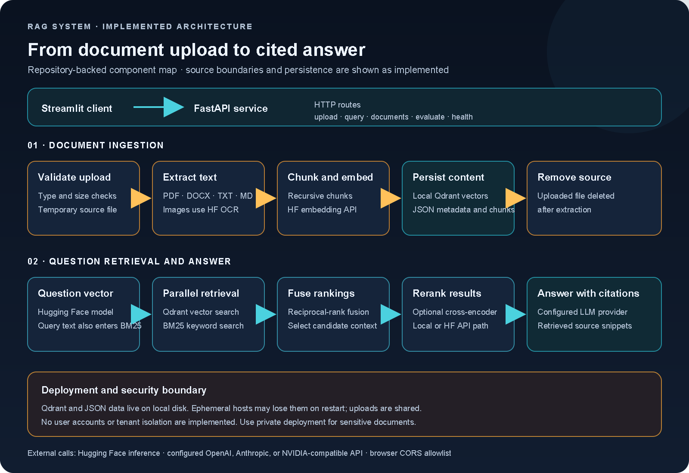
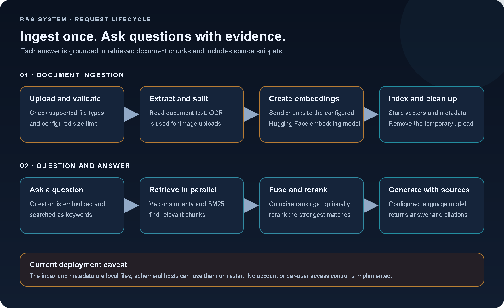

# RAG System

Document Q&A with ingestion, semantic and keyword retrieval, reranking, and cited answers.

**Live showcase:** [rag-chatbot-xi-beryl.vercel.app](https://rag-chatbot-xi-beryl.vercel.app/)  
**API health:** [saragadamkalyan-rag-system-backend.hf.space/health](https://saragadamkalyan-rag-system-backend.hf.space/health)

The repository runtime is a Streamlit client plus a FastAPI service. The public Vercel showcase is linked separately; the source here does not contain its Vercel frontend. The API health route returned `200` when this README was updated. That confirms the health endpoint only, not a full upload-to-answer production test.

## Architecture



[Editable SVG source](docs/images/rag-system-architecture.svg)



[Editable request-flow SVG](docs/images/rag-request-flow.svg)

See [the architecture notes](docs/architecture.md) for component boundaries, persistence, provider calls, and deployment limits. The older `rag for Production RAG Application.png` concept graphic listed tools that are not used by this source, so it is not presented as the implementation diagram.

## What the code implements

- Accepts PDF, DOCX, TXT, Markdown, PNG, and JPG/JPEG uploads, with extension and size checks.
- Extracts text locally for documents; image OCR uses the Hugging Face Inference API.
- Splits extracted text into overlapping chunks and requests embeddings from Hugging Face Inference API.
- Stores vectors in a local Qdrant collection and document/chunk metadata in a local JSON file.
- Combines vector and BM25 results with reciprocal-rank fusion; reranking uses an optional local cross-encoder or Hugging Face API, then falls back to fused ranking if the reranker is unavailable.
- Generates answers through configured OpenAI, Anthropic, or NVIDIA-compatible clients, with context-based fallback responses when generation is unavailable.
- Returns citations with the answer and exposes an evaluation endpoint.

## Run locally

Use Python 3.11, then start each process from the repository root:

```bash
python -m venv .venv
# Windows: .venv\\Scripts\\Activate.ps1
# macOS/Linux: source .venv/bin/activate
pip install -r backend/requirements.txt
pip install -r frontend/requirements.txt
```

Copy `.env.example` to `.env`, set the model provider and keys you intend to use, then run:

```bash
uvicorn app.main:app --app-dir backend --reload
```

In a second terminal:

```bash
streamlit run frontend/app.py
```

Or use Docker Compose:

```bash
docker compose up --build
```

## API

| Method | Path | Purpose |
|---|---|---|
| GET | `/health` | Service health |
| POST | `/upload` | Extract, chunk, embed, and index one document |
| POST | `/query` | Retrieve context and generate an answer |
| GET | `/documents` | List indexed documents |
| DELETE | `/documents/{doc_id}` | Remove a document and its indexed content |
| POST | `/evaluate` | Evaluate an answer against a reference |

For credentialed browser clients, set `CORS_ORIGINS` to comma-separated, exact trusted origins. It is empty by default; do not use `*` with credentials. See [.env.example](.env.example).

## Persistence and deployment

The current storage is local Qdrant plus `document_store.json`; uploaded source files are temporary and removed after extraction. This setup is suitable for local/demo use. A container host with ephemeral storage can lose the index and metadata on restart. Durable multi-instance deployment needs a shared persistent vector/document store and an explicit backup strategy; this repo does not claim those are configured.

The API has no caller authentication or per-user document isolation. CORS limits browser origins; it does not protect the API from direct HTTP clients. Keep the demo data non-sensitive and deploy behind an access-control layer before accepting private documents.

`render.yaml` describes the optional Render deployment. Configure provider keys in the deployment secret manager, set `CORS_ORIGINS` only to trusted origins, and attach durable storage before treating the service as production-persistent. The separate Vercel showcase is linked above and is not deployed from this repository's Streamlit frontend.

## Tests and lint

```bash
python -m pytest tests/ -v
ruff check backend/app/ --ignore=E501
```

CI runs the same test and Ruff checks on pushes and pull requests to `main`.
