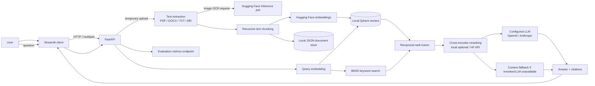
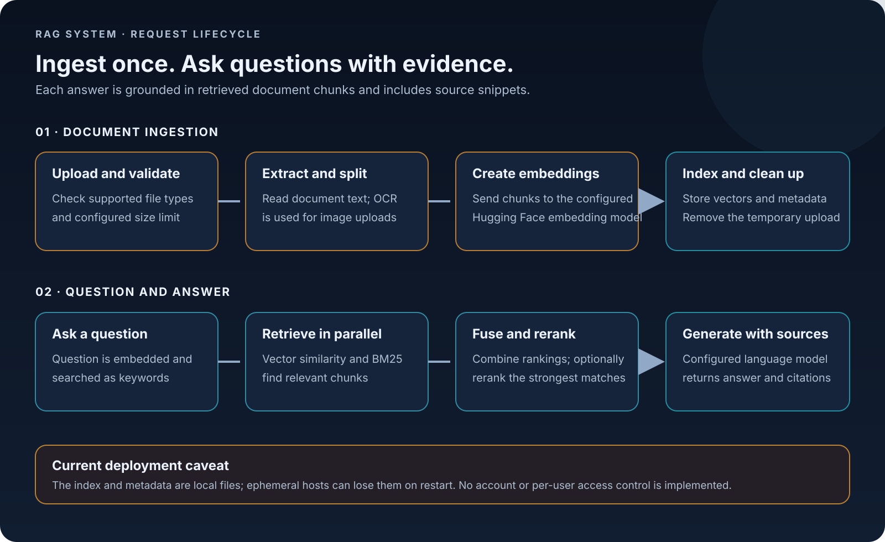

# Architecture and runtime boundaries

This diagram is based on the current source tree. It describes the implementation in this repository, not the separate Vercel showcase interface.

## Services and persistence

## Request flow

1. The API validates the file extension and maximum byte size, saves a temporary copy, extracts text, and removes the temporary file in a `finally` block.
2. Text is split into overlapping chunks. Embeddings are requested from Hugging Face; vectors and chunk payloads are stored in local Qdrant, while document metadata and chunk text are written to a JSON file.
3. A query runs vector search and BM25, combines rankings with reciprocal-rank fusion, then attempts cross-encoder reranking. If the hosted reranker is unavailable, the code falls back to fused ranking.
4. The configured LLM produces the answer and citations. If generation is unavailable, the app returns a context-based fallback.

## Security and deployment limits

- Credentialed CORS accepts only the explicit origins in `CORS_ORIGINS`; the default is empty. Keep the list narrow and never use `*` with credentialed requests.
- Upload size and extension checks are enforced by the API. The document is processed as a shared collection; the app has no per-user account or document-ownership model.
- No Clerk integration is added because the current app has no user account flow. No Neon integration is added because the current implementation uses Qdrant plus a JSON document store. Uploaded originals are temporary, so R2 is not wired into the current workflow.
- Qdrant and JSON data are stored on local disk. Ephemeral deployment storage can lose them after restart; multi-instance production needs a durable shared store and a tested backup/restore plan.
- Uploaded files and prompts are sent to the configured inference/LLM providers when those features are used. Do not upload confidential documents unless those provider data-handling terms are appropriate.
- The API currently does not authenticate callers or isolate tenants. Deploy it only in a trusted demo environment until an app-level access model is designed and tested.
- The health endpoint was reachable at the linked Hugging Face URL during this update. A full live upload, retrieval, and answer workflow was not exercised.
